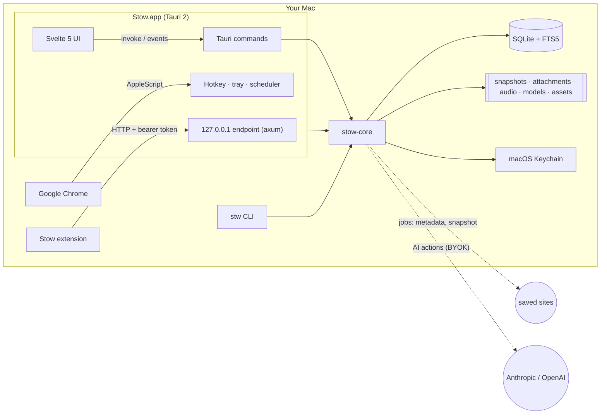

<h1 align="center">Stow</h1>

<p align="center"><strong>Close the tab. Keep the intent.</strong><br>
A local-first macOS app that parks Chrome tabs in buckets, with notes, tasks, reminders, files, and voice notes.</p>

<p align="center">
  <a href="https://github.com/ChaosDeSelva/Stow/releases/latest"></a>
  <a href="https://github.com/ChaosDeSelva/Stow/actions/workflows/ci.yml"></a>
  
  <a href="#license"></a>
</p>

<!-- TODO: add docs/assets/screenshot-main.png and uncomment.
<p align="center"></p>
-->
<!-- TODO: add docs/assets/screenshot-capture.png and uncomment.
<p align="center"></p>
-->

## What it does

- Press <kbd>⌃</kbd><kbd>⌘</kbd><kbd>S</kbd> over any Chrome tab, pick a bucket, press <kbd>⏎</kbd>. The tab is saved and closed.
- Buckets hold an *intent* ("watch for the business", "sources for the post"), not just links. Unsorted links wait in the **Inbox**; finished ones go to **Archived**.
- Every link keeps an offline readable copy, plus Markdown notes, tasks, reminders, files, and voice notes transcribed on your Mac.
- **Today** collects what is overdue, due, and coming up; reminders fire as macOS notifications even with the window closed.
- Full-text search (<kbd>⌘</kbd><kbd>K</kbd>) over titles, notes, saved pages, transcripts, and AI output. Optional AI actions use your own Anthropic or OpenAI key.
- Everything lives in one folder of SQLite and plain files. No account, no server, no telemetry. A `stw` command line, an MCP server for AI assistants, and a Chrome extension share the same library.

## Quick start

### Download

Get `Stow_<version>_aarch64.dmg` from [Releases](https://github.com/ChaosDeSelva/Stow/releases/latest), open it, and drag Stow to Applications. Stow needs macOS 13 or later. Release builds are for Apple Silicon; Intel Macs can build from source. The same release has `stow-cli_<version>_aarch64-apple-darwin.tar.gz` (the `stw` binary) and `stow-extension_<version>.zip`.

### Build from source

You need Xcode Command Line Tools, Rust via [rustup](https://rustup.rs) (`rust-toolchain.toml` picks the channel and adds rustfmt and clippy), CMake to compile whisper.cpp, and Node 22 (`.nvmrc`).

```bash
curl https://sh.rustup.rs -sSf | sh        # Rust
brew install cmake                         # builds whisper.cpp
# Node 22: nvm use (reads .nvmrc), or brew install node@22

git clone https://github.com/ChaosDeSelva/Stow && cd Stow
cd apps/stow-app && npm install
npm run tauri dev                          # run the app against your data folder (STOW_DATA_DIR=... to use another)
npm run tauri build                        # Stow.app and a .dmg under target/release/bundle/

cd ../..
cargo build -p stow-cli --release          # the CLI: target/release/stw
```

The first `cargo` build compiles whisper.cpp and takes a few minutes. With [just](https://github.com/casey/just) installed, `just setup`, `just dev`, `just build`, `just test`, and `just lint` wrap the same commands; `just dev` runs against a separate `Stow-dev` data folder. [CONTRIBUTING.md](CONTRIBUTING.md) has the development details.

## First run

1. **Open Stow.** It puts an icon in the menu bar and opens its window: navigation on the left (**Get set up**, **Inbox**, **Today**, **Archived**, **All items**, your **Buckets**, **Settings**), the list in the middle, and the details of the selected link on the right.
2. **Get set up** is selected on first launch, with a `0/6` badge. Its six steps are all optional: **Save your first tab**, **Let Stow see your Chrome tab**, **Turn on reminders**, **Add the Chrome button**, **Add an AI key**, and **Voice notes**. Steps tick themselves off as you use the features; **Dismiss checklist** hides the view, and Settings → General → **Show setup checklist** brings it back.
3. **Permissions are requested when first needed**, never up front:

   | Permission | When macOS asks | If you declined |
   |---|---|---|
   | **Automation → Google Chrome** | The first <kbd>⌃</kbd><kbd>⌘</kbd><kbd>S</kbd>, or **Allow access** in Get set up. Stow reads the front tab's address and title, and closes the tab if you asked. | The capture panel says Stow isn't allowed to control Chrome and lets you paste a link instead. Settings → Permissions → **Open Privacy Settings** opens the right pane. |
   | **Notifications** | The first reminder, or **Allow notifications** in Get set up. | System Settings → Notifications → Stow. |
   | **Microphone** | The first **Record**. | System Settings → Privacy & Security → Microphone → Stow. |

4. **Press <kbd>⌃</kbd><kbd>⌘</kbd><kbd>S</kbd> with Chrome in front.** The capture panel shows the tab's address and title with the bucket picker focused. Type to filter or create a bucket, press <kbd>⏎</kbd>. **Close tab in Chrome** is ticked by default. Change the shortcut under Settings → Capture → **Quick capture shortcut**.
5. **Closing the window does not quit Stow.** It stays in the menu bar so reminders fire and the shortcut keeps working. Quit from the menu-bar icon or with <kbd>⌘</kbd><kbd>Q</kbd>, or choose Settings → General → When I close the window → **Quit Stow**. Launching Stow a second time just brings the running copy forward.

## Everyday use

The complete walkthrough is [docs/user-guide.md](docs/user-guide.md).

- **Capture.** <kbd>⌃</kbd><kbd>⌘</kbd><kbd>S</kbd> from Chrome; <kbd>⌘</kbd><kbd>V</kbd> with a link on the clipboard anywhere in the main window; **Paste Link from Clipboard** in the menu-bar menu; **Import all Chrome tabs…** (Settings → Capture) for a whole window of tabs.
- **Add link** (<kbd>⌘</kbd><kbd>L</kbd>). The button above every list opens a field that takes one link or many, separated by commas, spaces, or new lines. It pre-fills from the clipboard, counts the links it found, lets you set a title when there is just one, and saves the batch into the bucket you pick. Duplicates are reported, not duplicated.
- **Buckets.** Each link belongs to one bucket or the Inbox. Drag a row onto a bucket, use **Move to…** from the row's menu, or press <kbd>M</kbd>. Buckets have an emoji, a description, their own notes, tasks, reminders, files, and recordings. <kbd>⌘</kbd><kbd>N</kbd> creates one.
- **Archive.** Press <kbd>A</kbd>, or hover a row and click **Archive**, when you're done with a link. It moves to the **Archived** view, where **Restore** brings it back; inside a bucket, **Show archived** reveals its archived links. <kbd>⌫</kbd> deletes. Archive and Delete both show an **Undo** toast for six seconds.
- **Several at once.** <kbd>⌘</kbd>-click toggles rows, <kbd>⇧</kbd>-click selects a range, <kbd>⌘</kbd><kbd>A</kbd> selects everything shown. A bar offers **Archive** (or **Restore**), **Move to…**, and **Delete** for the whole batch.
- **Search.** <kbd>⌘</kbd><kbd>K</kbd> (or <kbd>⌘</kbd><kbd>F</kbd>). Matches titles, descriptions, notes, readable copies, transcripts, and AI output; titles rank higher.
- **Today and reminders.** Set a reminder on a link, bucket, or task with a quick time (**+1h**, **Tonight**, **Tomorrow 9:00**, **Next week**, **This weekend**, **Next Monday**) or a date. **Today** (<kbd>⌘</kbd><kbd>2</kbd>) lists **Overdue**, **Today**, and **Upcoming** with snooze. Clicking a notification opens the right link; the menu-bar menu lists up to three due reminders.
- **Readable copy.** The **Page** tab keeps an offline Markdown copy of the article; remote images load only if you turn on **Load images** for that item. **Download page again** refreshes it. Video pages show a thumbnail and a **Watch** button instead.
- **Files.** Drop files onto the detail pane or click **Add files…**. Stow keeps its own copy.
- **Voice notes.** **Record** on any link or bucket, **Stop** to save. Transcription runs on your Mac with whisper.cpp; the model (`base.en`, 142 MB, by default) downloads on first use and the transcript is searchable and can be inserted into notes.
- **AI with your key.** Settings → AI: pick Anthropic or OpenAI and paste a key; it goes to the macOS Keychain. The **AI** tab offers **Summarize page**, **Summarize notes**, **Summarize recording**, **Suggest tasks** (with a preview that adds them as tasks), and **Fix title & description** when a page has no proper title. Nothing is sent until you click an action, and the first click asks for confirmation.

## Chrome extension

Optional: a toolbar button and **Stow this page** / **Stow this link** context menus. Load the unpacked extension from `chrome://extensions` (Developer mode → **Load unpacked**); Settings → Chrome extension → **Show extension folder** reveals the copy bundled inside Stow.app. Then open the extension's options and either

- click **Pair automatically** and approve the **Allow / Deny** prompt that Stow shows, or
- copy the **Pairing code** from Settings → Chrome extension and paste it into **Pairing code** → **Save**.

The extension talks only to Stow on `127.0.0.1`. Details and troubleshooting: [docs/extension.md](docs/extension.md).

## CLI cheat sheet

`stw` works on the same library as the app; both can be open at once.

```bash
stw add https://example.com/article -b reading   # save into "reading" (created if missing); fetches metadata and a readable copy
stw add <url> --no-fetch --title "My title"      # save without fetching; set the title yourself
stw ls                                          # Inbox · -b <bucket> · --all · --json
stw buckets                                     # list buckets with counts · stw buckets new "name"
stw mv <item> <bucket>                          # move (id or unique id prefix); `inbox` for the Inbox
stw search whisper metal                        # full-text search, 25 hits · --rebuild-index repairs the index
stw done <item>                                 # archive · --undo restores
stw open <item>                                 # print the URL · --browser opens it
stw rm <item>                                   # delete with notes, tasks, files, recordings
stw export --format markdown ~/Desktop          # Markdown folders · --format json for one file
stw backup ~/Desktop/stow.db                    # consistent copy of the database, safe while the app runs
stw doctor                                      # integrity check, search-index check, counts, unfinished jobs · --json
stw mcp                                         # serve the library to an MCP client over stdio · --read-only hides the writing tools
```

Exit code 3 means the bucket or item was not found; `stw doctor` exits 1 when it finds a problem. `--data-dir` / `STOW_DATA_DIR` picks another library; `--allow-local-urls` / `STOW_ALLOW_LOCAL_URLS=1` lets `add` fetch `localhost` and private addresses.

`stw mcp` lets an MCP client such as Claude Desktop or Claude Code search your library, read a link's notes and readable text (`get_item`, `stow://item/{id}`), and, unless you pass `--read-only` (or set `STOW_MCP_READ_ONLY=1`), add links, move or archive items, edit notes, add tasks and reminders, and export. It talks to the same local database; nothing is sent anywhere by Stow itself.

## Privacy and data

Stow has no account, no telemetry, and no analytics, and the authors run no server. These are the only network requests it makes:

| Request | When | Goes to |
|---|---|---|
| Page metadata, favicon, preview image, readable copy | When you save a link, or click **Download page again** | The site you saved (and `www.youtube.com/oembed` for YouTube links) |
| Images inside a saved page | Only while **Load images** is on for that item | The sites hosting those images |
| AI action | Only when you click an AI action, after a one-time confirmation | `api.anthropic.com` or `api.openai.com`, with your key and the text of that page, your notes, or a transcript |
| Whisper model | First transcription, or **Download now** | `huggingface.co` (whisper.cpp model files, pinned to one revision, size and SHA-256 verified) |

Saving never waits on the network; fetching runs in the background. Links to `localhost` or private addresses are saved but not fetched unless you turn on **Fetch pages on private or local addresses** (Settings → Data → Advanced). Audio is recorded and transcribed on the Mac. The extension talks to `127.0.0.1` only, with a per-install token. The threat model and reporting process are in [SECURITY.md](SECURITY.md).

Everything is in `~/Library/Application Support/Stow/` (mode `0700`):

| What | Where |
|---|---|
| Database | `stow.db` (SQLite, WAL mode) |
| Readable copies | `snapshots/<item-id>.md`, `snapshots/<item-id>.html` |
| Attachments | `attachments/<attachment-id>/<filename>` |
| Recordings | `audio/<recording-id>.wav` (16 kHz mono) |
| Whisper models | `models/ggml-<name>.bin` (Settings → Data → Danger zone can delete them; downloaded again when needed) |
| Favicons and previews | `assets/<item-id>-favicon.<ext>`, `assets/<item-id>-image.<ext>` |

API keys are not in this folder: they're in your login Keychain under the service `io.github.chaosdeselva.stow`.

**Export and backup.** Time Machine covers the folder. Settings → Data has **Export as Markdown…** (a folder per bucket, a `.md` per link), **Export as JSON…** (every table in one file, minus the extension token), and **Back up database…** (an online SQLite backup, safe while Stow runs); `stw export` and `stw backup` do the same. **Delete all Stow data…** in the Danger zone wipes the folder and restarts with an empty library. Set `STOW_DATA_DIR=/path` for the app or CLI (or `--data-dir` for `stw`) to use a different folder.

## Architecture at a glance



| Path | What it is |
|---|---|
| `crates/stow-core` | All storage and logic: SQLite and migrations, URL canonicalization, metadata and snapshots with SSRF guards, the job queue (4 fetches, 1 transcription, 2 AI calls at a time; resumes after a quit), reminders, recording and Whisper transcription, AI providers, export, `doctor`. No UI. |
| `crates/stow-cli` | The `stw` command-line tool over stow-core. |
| `crates/stow-mcp` | The MCP server behind `stw mcp`: tools (`search`, `get_item`, `add_links`, …) and `stow://item/{id}` / `stow://bucket/{id}` resources over stdio, with a read-only mode. |
| `apps/stow-app` | The Tauri 2 shell (`src-tauri/`: windows, tray, hotkey, Chrome AppleScript, notifications, permissions, scheduler, localhost endpoint) and the Svelte 5 frontend (`src/`). |
| `extension/` | The Chrome MV3 extension, also bundled at `Stow.app/Contents/Resources/extension`. |
| `docs/architecture` | [Overview](docs/architecture/README.md) · [Data model](docs/architecture/data-model.md) · [Jobs and fetching](docs/architecture/jobs-and-fetch.md) · [IPC contract](docs/architecture/ipc-contract.md) · [Decision records](docs/architecture/adr/) |

The documentation index is [docs/README.md](docs/README.md).

## Contributing

Read [CONTRIBUTING.md](CONTRIBUTING.md) for the dev loop, tests, and how to add a command or a migration. Questions go to [Discussions](https://github.com/ChaosDeSelva/Stow/discussions) and bugs to the [issue tracker](https://github.com/ChaosDeSelva/Stow/issues/new/choose); see [SUPPORT.md](SUPPORT.md) for what to include. The project follows the [Code of Conduct](CODE_OF_CONDUCT.md).

## Security

Report vulnerabilities privately through [GitHub private vulnerability reporting](https://github.com/ChaosDeSelva/Stow/security/advisories/new) or by email to SECURITY_EMAIL; [SECURITY.md](SECURITY.md) has the policy, response times, and the threat model.

## License

Licensed under either of [Apache License 2.0](LICENSE-APACHE) or [MIT](LICENSE-MIT), at your option. Bundled third-party assets keep their own licenses; see [THIRD_PARTY_NOTICES.md](THIRD_PARTY_NOTICES.md).

Unless you explicitly state otherwise, any contribution intentionally submitted for inclusion in Stow by you, as defined in the Apache-2.0 license, shall be dual licensed as above, without any additional terms or conditions.

## Credits

- [IBM Plex Sans](https://github.com/IBM/plex) (SIL OFL 1.1) and [Font Awesome Free](https://fontawesome.com) icons (CC BY 4.0).
- On-device transcription by [whisper.cpp](https://github.com/ggml-org/whisper.cpp) through [whisper-rs](https://codeberg.org/tazz4843/whisper-rs); models from OpenAI's Whisper.
- Built with [Tauri](https://tauri.app), [Svelte](https://svelte.dev), [SQLite](https://sqlite.org), and [axum](https://github.com/tokio-rs/axum).
